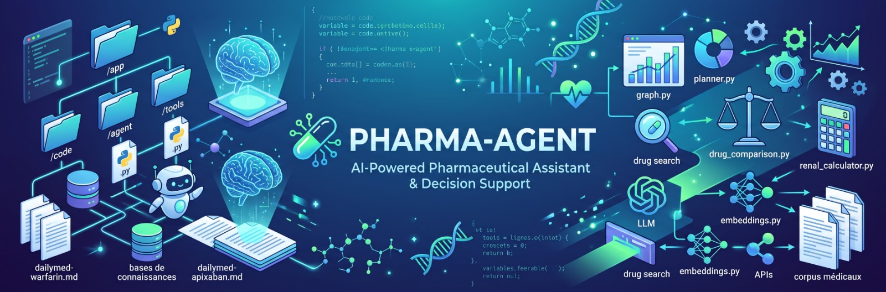
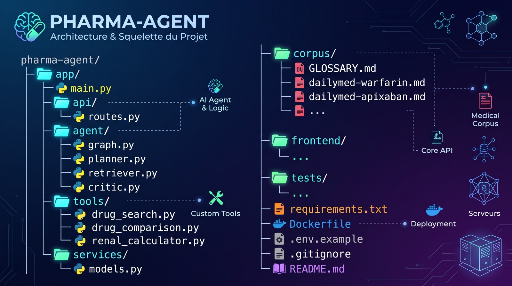
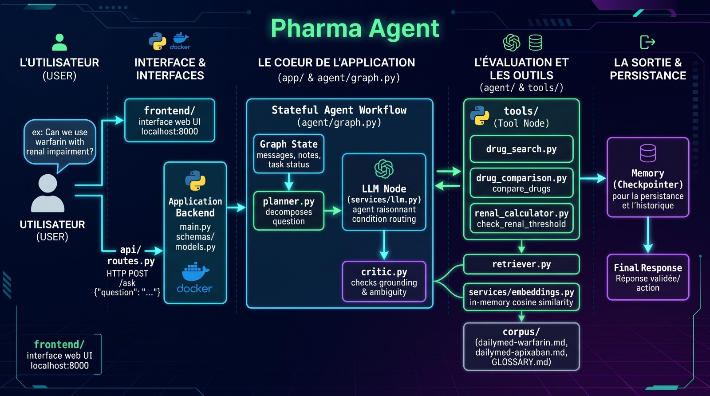

# Pharma Agent 



**Pharma Agent** is an AI-powered, agentic research assistant designed to navigate a local corpus of drug labels (sourced from DailyMed / MedlinePlus). It acts as an intelligent decision-support tool, helping users extract information, compare medications, and evaluate clinical safety parameters through a stateful multi-agent workflow.

> ⚠️ **Disclaimer:** This project is a technical exercise and demonstration of Agentic AI workflows. It is **not** intended for clinical use and **does not** constitute medical advice.

---

##  Architecture & Workflow

The application is built around a stateful, graph-based architecture. The LLM acts as the reasoning engine, delegating tasks to specialized tools and validating outputs before returning a final response.

### The Agentic Flow (`START → planner → agent ⇄ tools → critic → END`)



*   **Planner:** Decomposes complex user questions into actionable sub-questions.
*   **Agent (LLM):** Analyzes the planner's output and routes the query to the appropriate custom tools.
*   **Tools:** Specialized Python functions used by the agent:
    *   `drug_search`: Retrieves specific drug information from the corpus.
    *   `drug_comparison`: Cross-references different medications.
    *   `renal_calculator`: Checks dosage thresholds based on renal impairment.
*   **Retriever:** Uses in-memory cosine similarity over embedded document chunks to fetch the most relevant context.
*   **Critic:** Acts as a safety net. It reviews the drafted response to ensure it is strictly grounded in the retrieved corpus, flagging any unsupported or ambiguous claims before outputting the final response.

### Project Structure



---

##  Quick Start & Deployment

The project is fully containerized using Docker for easy deployment. 

### 1. Prerequisites
Ensure you have [Docker](https://docs.docker.com/get-docker/) installed on your machine. You will also need API keys for your preferred LLM provider (e.g., OpenAI, Anthropic).

### 2. Environment Setup
Clone the repository and create your environment file:
```bash
git clone https://github.com/hibasgr2/pharma-agent.git
cd pharma-agent
```
### 3. Build & Run with Docker
#### Build the Docker image:
```bash
docker build --no-cache -t agent .
```
#### Run the container:
```bash
docker run --rm --name agent -p 8000:8000 --env-file .env -v "$(pwd)/frontend:/app/frontend" agent
```
### 4. Access the Application
Web UI: Open your browser and navigate to http://localhost:8000 <br>
API Documentation: Access the interactive API docs at http://localhost:8000/docs


